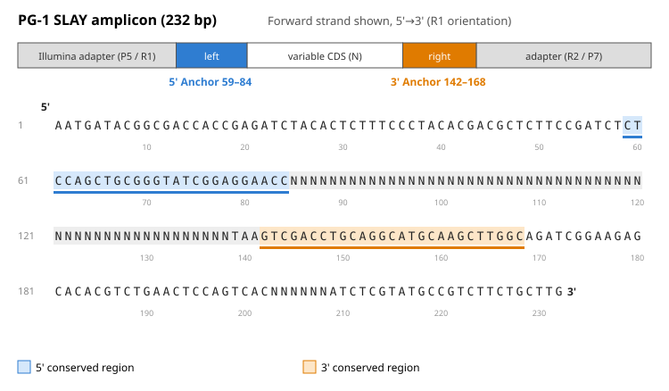

# dmSLAY protocol

This repository provides a reproducible Pixi workflow for processing paired amplicon reads:
merge reads, trim amplicon flanks and adapters, count peptide sequences, and optionally
run differential-expression analysis with DESeq2.

## 1. Install the environment

Install [Pixi](https://pixi.sh/), then run these commands from the repository root:

```bash
pixi install
pixi run analyze --help
```

Pixi installs the tools and R/Python packages declared in `pixi.toml`. The committed
`pixi.lock` records the resolved versions for reproducible environments.

## 2. Prepare paired-read inputs

Place the FASTQ files in an input directory. Every sample must have both mates.
The workflow recognizes common naming patterns such as:

```text
sample_R1.fastq.gz   sample_R2.fastq.gz
sample_1.fastq.gz    sample_2.fastq.gz
sample_F.fastq.gz    sample_R.fastq.gz
sample_L001_R1_001.fastq.gz   sample_L001_R2_001.fastq.gz
```

If a mate is missing, merging stops and prints the sample and unmatched filename.

The 5-prime and 3-prime values are the flanking sequences immediately outside the
region of interest, see figure below.  



Both sequences are required; see below the sequences in the example data:
```text
5-prime: CTCCAGCTGCGGGTATCGGAGGAACC
3-prime: GTCGACCTGCAGGCATG
```

For amplicon selection, the 5-prime flank is passed to `seqkit amplicon -F`. The
3-prime flank is reverse-complemented for `seqkit amplicon -R`. By default, the
same two flank sequences are used as the left and right Flexbar adapter sequences.
The workflow accepts flank sequences directly and will convert it into fasta files     
and generate the reverve complenet of the 3' required by flexbar.


## 3. Configure DESeq2 analysis

DESeq2 requires a group for every sample. Supply this information in a TSV/CSV
metadata file with `--coldata-file`.

For a metadata file, the script recognizes these sample-column names:
`sample`, `sample_id`, `sample_name`, `Sample`, `SampleID`, or `name`. It recognizes
these group-column names: `group`, `condition`, `treatment`, or `phenotype`.

```tsv
sample	condition
S1	Control
S2	Control
S3	Control
S4	Treated
S5	Treated
S6	Treated
```

Every count-table sample must occur exactly once in the metadata. If no reference
group is specified, the first group is used. If no treatment is specified, each
non-reference group is compared against the reference. Set `--deseq2-output-dir`
to change the output location. The minimum count for DESeq2 is 30 by default.


## 4. Run the full analysis

Run the complete workflow with all required arguments:

```bash
pixi run analyze --input-dir data/example/FASTQ/ \
  --five-prime-sequence CTCCAGCTGCGGGTATCGGAGGAACC \
  --three-prime-sequence GTCGACCTGCAGGCATG \
  --coldata-file data/example/coldata.tsv \
  --deseq2-reference Control \
  --deseq2-treatment Treated
```

`--input-dir`, `--five-prime-sequence`, `--three-prime-sequence`, and
`--coldata-file` are required. The script reports any missing arguments before
starting the pipeline.

The workflow reads input data from the directory provided with `--input-dir`. By
default, all generated files are written under `results/` using the name of the
input directory's parent. For example, `--input-dir data/PG1/FASTQ` writes
outputs under `results/PG1/`:

- **Merge:** `fastp` writes merged and unmerged FASTQ files to
  `results/PG1/FASTQ_merged/` and HTML/JSON reports to
  `results/PG1/fastp_reports/`.
- **Trim:** `seqkit` selects the amplicon and `flexbar` trims adapters, writing FASTA
  files to `results/PG1/FASTA_trimmed/`.
- **Count:** translated peptide sequences are counted across samples and written to
  `results/PG1/counts/peptide_read_counts.txt`. By default, peptides with fewer
  than 10 total reads are filtered out.
- **DESeq2:** uses the required `--coldata-file`. Results are written to
  `results/PG1/deseq2/` by default.

The main workflow options are:

| Option | Purpose | Default |
| --- | --- | --- |
| `--input-dir DIR` | Paired FASTQ input directory | Required |
| `--merged-dir DIR` | Merged FASTQ output | `results/<parent-name>/FASTQ_merged/` |
| `--trimmed-dir DIR` | Trimmed FASTA output | `results/<parent-name>/FASTA_trimmed/` |
| `--results-dir DIR` | Peptide-count output directory | `results/<parent-name>/counts/` |
| `--report-dir DIR` | fastp HTML/JSON reports | `results/<parent-name>/fastp_reports/` |
| `--deseq2-output-dir DIR` | DESeq2 output directory | `results/<parent-name>/deseq2/` |
| `--coldata-file FILE` | Sample and group metadata | Required |
| `--threads N` | Worker threads for trimming tools | `32` |
| `--minimum-count N` | Minimum total reads per peptide | `10` |
| `--five-prime-sequence SEQ` | 5-prime flank | Required |
| `--three-prime-sequence SEQ` | 3-prime flank | Required |

Run `pixi run analyze --help` for the complete option list.


## 5. Run individual stages

These tasks are useful when you want to run or repeat a single stage. Run them in
pipeline order, using the previous stage's output as the next stage's input.

```bash
pixi run merge --input-dir data/example/FASTQ

pixi run trim -i results/example/FASTQ_merged \
  -5 CTCCAGCTGCGGGTATCGGAGGAACC \
  -3 GTCGACCTGCAGGCATG

pixi run count -i results/example/FASTA_trimmed

pixi run deseq2 \
  --count-file results/example/counts/peptide_read_counts.txt \
  --coldata-file data/examplecoldata.tsv \
  --reference Control \
  --treatment Treated
```

## Troubleshooting installation

If Pixi is interrupted while installing or got stuck, rerun `pixi install`.

```bash
# First remove the generated workspace environment
rm -rf .pixi
rm -f pixi.lock

# And Then: On a network-backed cache, point Pixi to a local cache to reduce filesystem I/O:
export PIXI_CACHE_DIR="/tmp/pixi-cache-${USER}"
export PIXI_NO_PROGRESS=1

# and recreate it:
pixi install
```
